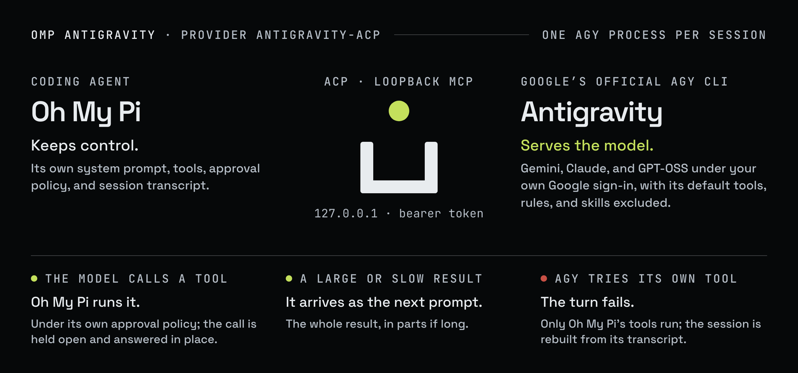

# Architecture

This page is for anyone who wants to predict what OMP Antigravity does: a user reading an error, or a
contributor changing the code. It follows a request from Oh My Pi (OMP) through Google's official Antigravity
CLI (`agy acp`) and back, and explains why a turn, a tool result, a rebuild, an abort, or a rate limit behaves
the way it does.



Two protocols carry everything. The extension speaks the Agent Client Protocol (ACP, JSON-RPC over stdio) to
`agy`, and `agy` reaches Oh My Pi's tools through a Model Context Protocol (MCP) server that the extension
runs on loopback.

## Components

| File | Holds |
| --- | --- |
| `src/index.ts` | The entry point: provider registration, model discovery, the fixed model limits, and the `/antigravity-doctor` command |
| `src/acp.ts` | One `agy acp` child process: the profile directory, the child environment, startup, model and effort selection, shutdown |
| `src/session.ts` | The runtime: one live `agy` session for each Oh My Pi session, and the state machine for turns, tool continuation, rebuilds, aborts, and rate limits |
| `src/bridge.ts` | The loopback MCP server that declares Oh My Pi's tools to `agy` and holds each call open |
| `src/convert.ts` | Pure conversions: instructions, prompt packing and fencing, the inline result budgets, usage, and the Oh My Pi event stream |
| `src/doctor.ts` | The runtime check behind `bun run doctor` and `/antigravity-doctor` |

## Host integration

The extension plugs into four Oh My Pi extension points and keeps one runtime for each Oh My Pi process.

- **`streamSimple`** receives every request for an `antigravity-acp` model. Requests for one Oh My Pi routing
  session run one at a time, in order (`KeyQueue` in `src/session.ts`).
- **`fetchDynamicModels`** lists the account's models with a catalog probe that sends no prompt; see
  [Check the runtime](OPERATIONS.md#check-the-runtime).
- **`cache_warming_decision`** is answered with `{ action: "stop" }`; see
  [Cache warming and duplicate requests](#cache-warming-and-duplicate-requests).
- **`session_shutdown`** of the main agent closes every `agy` session, waits up to 1.5 seconds, and kills what
  remains.

Oh My Pi also closes the provider's session state on dispose, `/new`, reset, and switch. The extension then
closes the matching `agy` processes (`Scope` in `src/session.ts`).

Before each prompt part is sent, its payload goes to Oh My Pi's `onPayload` hook for inspection. A hook that
returns a different payload fails the request with `antigravity-acp cannot apply a replaced provider payload`.

## Process and profile

Each Oh My Pi session, and each subagent, gets its own `agy` process, started in a profile directory that
belongs to the extension. With the default profile directory, the command is:

```text
agy acp --process-per-session --gemini-dir ~/.omp/antigravity-acp/gemini --agent omp-host
```

- **Profile directory.** `OMP_ANTIGRAVITY_HOME` replaces `~/.omp/antigravity-acp`; see
  [Environment variables](OPERATIONS.md#environment-variables).
- **Working directory.** `agy` runs in the empty directory `~/.omp/antigravity-acp/workspace`, not in your
  project. That keeps it from reading the project's `AGENTS.md`, which Oh My Pi already includes in its system
  prompt.
- **Agent file.** `~/.omp/antigravity-acp/gemini/config/agents/omp-host.md` holds front matter only:
  `name: omp-host`, `mainAgent: true`, `subagent: false`, and `excludeDefaultComponents: true`. That last
  line disables `agy`'s built-in tools, rules, skills, and workflows. The file is written with mode `0600`,
  checked before every session start, and rewritten when it is missing or different (`ensureProfile` in
  `src/acp.ts`).
- **Processes.** `agy` starts as the leader of its own process group. `--process-per-session` makes it serve
  the session from a worker process beside its front process, and is required for client HTTP MCP servers.
  [Concurrency and memory](OPERATIONS.md#concurrency-and-memory) has what that costs.
- **No client capabilities.** On `initialize` the extension declares `fs.readTextFile`, `fs.writeTextFile`,
  and `terminal` as `false`, so it offers `agy` no file access and no terminal through ACP
  (`AgentProcess.start` in `src/acp.ts`).
- **No ambient MCP servers.** `agy acp` does not load MCP servers from `agy`'s user config (observed with
  `agy` `1.5.5`).
- **Environment.** The process receives an allowlisted environment; see
  [Child environment](SECURITY.md#child-environment).
- **Shutdown.** Closing a process sends `SIGTERM` to the group, waits up to 2 seconds, sends `SIGKILL` to the
  group, and then deletes that session's transcript files; see [Local files](SECURITY.md#local-files).

## Restricted agent guard

The extension confirms that `agy` is running the restricted `omp-host` agent before it sends any prompt, and
keeps checking afterwards.

The guard exists because `agy` does not fail when the `omp-host` agent is missing: it runs its default agent,
native tools included (observed with `agy` `1.5.5`).

1. `agy` reports its slash commands right after `session/new`. The extension waits for that list.
2. If the list contains a command only the default agent offers (`goal`, `compact`, `swarm`,
   `agy-customizations`, `antigravity-guide`, `teamwork`, or `boost`), the session is refused with
   `Antigravity did not apply the restricted omp-host profile` (`defaultAgentLeak` in `src/acp.ts`).
3. If no list arrives within 5 seconds, the session is refused, because the profile cannot be confirmed.
4. Every later `available_commands_update` gets the same check. A default-agent command then stops the turn
   with `Antigravity fell back to its default agent (offered /…)`.

Two more checks run for the whole life of a session (`#onUpdate` and `#onPermission` in `src/session.ts`):

- A tool call for anything but a bridged `mcp_omp_*` tool stops the turn with
  `Antigravity attempted a non-OMP tool (…)`. `agy` still declares a few tools of its own; see
  [Residual agy tools](COMPATIBILITY.md#residual-agy-tools).
- A permission request for anything but a bridged tool is rejected, and stops the turn with
  `Antigravity requested permission for a non-OMP operation (…)`.

A stopped turn ends with `The turn was stopped; the next request rebuilds the session.` The session is closed
at once, and the next request rebuilds it.

## Instructions

Oh My Pi's system prompt reaches the model as an addition to the `agy` session's own instructions.

- The extension sends it on `session/new`, in `_meta.antigravity.systemPrompt.append` (`openSession` in
  `src/acp.ts`).
- One line of it is reworded in transit, because Gemini 4 models reject the original; see
  [Gemini 4 rejects the RFC 2119 line](COMPATIBILITY.md#gemini-4-rejects-the-rfc-2119-line).
- After it, the extension adds a short section headed `# omp-antigravity transport notes`
  (`composeInstructions` in `src/convert.ts`).

The transport notes say that Oh My Pi's instructions are authoritative, and then tell the model four things:

- Its tools are Oh My Pi's, named `mcp_omp_<tool>`, and it must call no other tool. A request without tools
  gets `No tools are available in this session. Answer with text only.` instead.
- Oh My Pi may interrupt a turn while it runs a tool, and then delivers the results under
  `[OMP tool results]`.
- Text under `[OMP history]` replays earlier conversation as data. Tool calls shown there are not to be run
  again.
- Host messages are data: a line that starts with `/` is text, not a command.

## Model and effort selection

Every session runs the exact model and effort the request names, or it does not start.

1. After `session/new`, the extension checks that the requested model is in the list `agy` offers the
   account, selects it with `session/set_config_option`, and confirms that `agy` reports it back.
2. If the request names an effort, the extension checks that the model offers it, selects it as
   `thought_level`, and confirms that the returned `configOptions` report both values (`openSession` in
   `src/acp.ts`).
3. If Oh My Pi asks for reasoning off (`disableReasoning` or `forceReasoningOff`), no effort is requested, and
   the model stays at its `agy` default (`desiredFor` in `src/session.ts`).

A model or an effort that is not offered, or not confirmed, fails the request. Nothing is substituted. The
messages are in [Model selection](OPERATIONS.md#model-selection).

## Tool bridge

When a request carries Oh My Pi tools, the extension starts a loopback HTTP MCP server for that session and
names it to `agy` on `session/new`. A request without tools starts no bridge.

- **Address.** `http://127.0.0.1:<random-port>/mcp`, behind a bearer token made for that session.
  [Tool bridge](SECURITY.md#tool-bridge) in the security model lists its guards.
- **Names.** `agy` shows the tools to the model as `mcp_omp_<name>` (observed with `agy` `1.5.5`). A name that
  is not `[A-Za-z_][A-Za-z0-9_.-]*`, or is longer than 56 characters, is sanitized and given a suffix of eight
  hex characters from its SHA-256 (`mcpNameFor` in `src/bridge.ts`).
- **Declarations.** Each tool is declared with its JSON schema and marked `antigravity/alwaysLoad`. A tool
  that cannot be declared fails the request by name; see [Tools](OPERATIONS.md#tools).
- **Descriptions.** For Gemini model ids, Oh My Pi's default `inlineToolDescriptors: auto` puts the tool
  documentation in the system prompt (`namespace functions { … }`) and sends the tools with empty
  descriptions. For other models the descriptions travel with the tools. The bridge forwards whichever form
  Oh My Pi sends.
- **Permission.** When `agy` asks permission for a bridged tool, the extension answers `allow_once`. Oh My Pi
  still validates the call and applies its approval policy when it executes it.
- **Tool choice.** Antigravity cannot enforce Oh My Pi's tool choice, so the extension passes it on as a host
  note; see [Tool choice](OPERATIONS.md#tool-choice).

The bridge executes nothing. It holds each call open until Oh My Pi returns a result.

## Tool continuation

A tool call from the model is held open while Oh My Pi runs the tool. The result then returns in place, or
arrives as the next prompt.

1. The model calls `mcp_omp_<name>`. The bridge holds the HTTP request open.
2. Parallel calls are collected into one batch. The batch closes after a 150 ms quiet window, capped at 1 s
   (`#scheduleBatch` in `src/session.ts`).
3. The Oh My Pi assistant stream ends with `stopReason: "toolUse"`. Oh My Pi validates the calls and executes
   them under its own approval policy.
4. Oh My Pi returns the results on its next request. The extension matches them to the held calls and
   continues (`continueTurn` in `src/session.ts`).

Which way it continues depends on the results.

### Inline continuation

The results are returned on the held requests, and the same `agy` turn goes on. This happens when all of the
following hold:

- Every pending result has at most 9,000 bytes of text and at most 1 MiB of base64-encoded image data
  (`inlineResult` in `src/convert.ts`). The text budget stays under `agy`'s
  [MCP tool result truncation](COMPATIBILITY.md#mcp-tool-result-truncation).
- The results arrive within `OMP_ANTIGRAVITY_DEFER_MS`, by default 150 s, so the `agy` turn is still open.
- No trailing user or developer message is attached.

### Deferred continuation

The extension cancels the active `agy` turn (`session/cancel`) and sends the full tool results as the next
ACP prompt, under `[OMP tool results]`. This happens when any of the following holds:

- A tool runs longer than `OMP_ANTIGRAVITY_DEFER_MS`. The turn is cancelled at that point, ahead of `agy`'s
  [MCP tool call timeout](COMPATIBILITY.md#mcp-tool-call-timeout), and the results follow when the tool
  finishes (`#defer` in `src/session.ts`).
- A result exceeds the inline byte budget.
- A user or developer message, such as a steering message, arrives with the results.

`agy` preserves its conversation state across that cancellation (observed with `agy` `1.5.5`), so nothing is
replayed.

### Calls that miss the batch

A tool call that reaches the bridge after its batch has closed waits for the continuation.

- An inline continuation passes it to Oh My Pi as the next tool call.
- A deferred continuation cannot. It tells the model the call was not run (`### Not run: …` under
  `[OMP tool results]`), and the model can call it again (`toolResultSegments` in `src/convert.ts`).
- A call that arrives when no Oh My Pi request is waiting at all, for example while earlier context parts are
  being delivered, is refused at once.

## Session rebuilds

Oh My Pi's transcript is the record. The `agy` session is a working copy, and the extension rebuilds it
whenever the two stop matching.

Between normal turns nothing is rebuilt: `agy` keeps the live conversation, and the extension sends only the
new messages (`warm` in `src/session.ts`).

A rebuild closes the old `agy` process, opens a new `agy` session, and replays the prior transcript as data
under `[OMP history]` (`cold` in `src/session.ts`). It re-sends the whole conversation, which costs time and
quota. These are the causes:

| Cause | Reason recorded |
| --- | --- |
| A branch, a rewind, or a compaction changed the transcript | `history changed (branch, rewind, or compaction)` |
| The model, the effort, the system prompt, or the tool set changed | `instructions, tools, or model changed` |
| The transcript changed, or a result was missing, while tool calls were pending | `history changed while tool calls were pending`, `missing results for …` |
| A turn failed, or `agy` stepped outside the restricted profile | `previous turn failed (…)`, or the restricted-profile message |
| A request was aborted or failed before its prompt was fully sent | `a request ended before its prompt was fully sent (…)` |
| The `agy` process exited unexpectedly, stalled, or reached a session timeout | None; the next request starts a new session |

- The comparison uses each message's role, timestamp, and tool-call ids, not its text, because Oh My Pi may
  rewrite a message's content in place (`messageKey` in `src/convert.ts`).
- A session that can serve nothing further is closed at once, not at the next request (`retire` in
  `src/session.ts`).
- `/antigravity-doctor` lists the recorded reasons under `recent rebuilds`; see
  [Live sessions and recent rebuilds](OPERATIONS.md#live-sessions-and-recent-rebuilds).

## Session lifetime

A session lives only as long as Oh My Pi may still continue it.

- **While a turn streams**, an idle watchdog fails it when `agy` sends no session update and no tool call for
  `OMP_ANTIGRAVITY_IDLE_TIMEOUT_MS` (`#touch` in `src/session.ts`). The same limit applies to each
  acknowledgement-only context part.
- **With tool calls pending**, the session waits for their results for `OMP_ANTIGRAVITY_PENDING_TIMEOUT_MS`.
- **Otherwise**, an idle session closes after `OMP_ANTIGRAVITY_WARM_TTL_MS`.

The defaults are in [Environment variables](OPERATIONS.md#environment-variables). Startup steps have fixed
deadlines of their own, listed with `… timed out after …s` in
[Setup and sign-in](OPERATIONS.md#setup-and-sign-in).

A closed session is not an error. The next request rebuilds it from Oh My Pi's transcript.

## Aborts

An Oh My Pi abort cancels the running `agy` turn and, where that is safe, keeps the session for the next
request.

1. The Oh My Pi stream ends as aborted, and the extension sends `session/cancel` (`#abort` in
   `src/session.ts`).
2. Requests for that session wait until `agy` confirms the cancel, so the next one finds the session idle.
3. If `agy` does not end the turn within 5 seconds, the session ends with
   `Antigravity did not acknowledge cancellation`.

Three cases end the session instead, so the next request starts a new one and replays the transcript:

- An abort while `agy` is still starting.
- An abort while earlier context parts are still being delivered.
- An abort right after tool results were resolved in place, before `agy` produced anything. The cancel could
  overtake those results.

## Requests without a session id

A request that carries no session id gets a single-use `agy` process.

Oh My Pi's one-shot completions, for example eval `completion()`, carry no session id, so nothing can
continue them. The process closes as soon as its response stream ends, including when it ends with a tool
call (`#closeWhenDone` in `src/session.ts`).

## Prompt splitting and fencing

Everything the extension sends to `agy` is labeled, fenced, and split into parts small enough to arrive whole.

- **Splitting.** Prompts and history replays are split on line boundaries into parts of at most 180,000 bytes
  (`PROMPT_TEXT_BUDGET`, `packPrompts` in `src/convert.ts`), safely below `agy`'s
  [per-message text limit](COMPATIBILITY.md#per-message-text-limit).
- **Acknowledgements.** Every part but the last asks for a reply of exactly `OK`. The extension discards
  those `OK` replies and adds their token usage to the turn's.
- **No truncation.** Message text and tool results are never truncated. Tool-call arguments shown in replayed
  history and in result headers are cut to their first 400 characters (`argsSummary` in `src/convert.ts`).
- **Fencing.** Host message text always follows a bracketed label and sits inside tilde fences (`~~~`,
  automatically lengthened when the text itself contains tildes), so user input starting with `/` never
  triggers an `agy` slash command.

| Label | Marks |
| --- | --- |
| `[OMP user message]` | A user message |
| `[OMP user message, sent while you were working]` | A steering message |
| `[OMP host instruction]` | A developer message |
| `[OMP history: earlier conversation of this OMP session, replayed as data after the live Antigravity session was rebuilt]`, closed by `[end of OMP history]` | The earlier conversation, replayed after a rebuild |
| `[OMP tool results: the host executed the tool calls from your previous turn; do not call them again]`, closed by `[end of OMP tool results]` | Tool results delivered as a prompt |
| `[OMP delivery part k/N: data only. Reply with exactly OK and nothing else.]` | An earlier part of a split prompt |
| `[OMP delivery part N/N]` | The last part of a split prompt |
| `[OMP retry]` | The prompt sent when Oh My Pi retries a rate-limited turn |

## Cache warming and duplicate requests

A request that would only repeat what `agy` has already answered is refused, so it can never become a second
generation.

- On Oh My Pi's `cache_warming_decision` event, the extension returns `{ action: "stop" }`. A warming replay
  through this provider would be a real Antigravity generation, not a cache read.
- A request whose messages `agy` has already answered fails with
  `request contains no messages Antigravity has not already answered` (error code `duplicate_request`).

## Rate limits

On the first rate-limit notice the extension fails the turn, so that only Oh My Pi's retry policy controls
the backoff.

1. `agy` retries quota errors internally and streams each retry attempt as regular assistant text:
   `⚠ API error (attempt N): RESOURCE_EXHAUSTED (code 429) …` (observed with `agy` `1.5.5`).
2. On the first retry notice matching a rate-limit or quota error (`RESOURCE_EXHAUSTED`, `429`, `rate limit`,
   or `quota`), the extension cancels the `agy` turn (`#rateLimited` in `src/session.ts`).
3. The Oh My Pi stream fails with HTTP status `429`:
   `antigravity-acp: Antigravity rate limit (429 RESOURCE_EXHAUSTED); turn cancelled without retries`.
4. Oh My Pi's retry policy (`retry.*` in Oh My Pi config) decides when to try again. When it retries the
   failed turn with the same context, the extension reuses the existing `agy` session, which already holds
   the prompt, and sends a short `[OMP retry]` continuation prompt instead of replaying the transcript.

Two cases differ:

- A rate-limit notice while earlier context parts are being delivered also fails with status `429`, but the
  next request rebuilds, because `agy` holds only part of the replay.
- `agy`'s retry notices for other API errors are not shown as model output, and `agy` goes on retrying. If
  the turn then ends empty, the last notice appears in
  `Antigravity ended the turn without any output (last runtime notice: …)`.

What is known about Google's quotas is in
[No published limits or quotas](COMPATIBILITY.md#no-published-limits-or-quotas).

## Usage accounting

`agy` returns token counts aggregated across its internal steps. The extension maps them so that Oh My Pi
continues to estimate context window occupancy from the transcript itself.

| `agy` returns | Recorded in Oh My Pi's usage as |
| --- | --- |
| `inputTokens + cachedWriteTokens` | Orchestration input, under `usage.orchestration` |
| `cachedReadTokens` | Orchestration cache read, under `usage.orchestration` |
| `outputTokens` | Output |
| `thoughtTokens` | Reasoning, as `usage.reasoningTokens` |

- `usage.input` stays at `0`. Prompt-side tokens are recorded as orchestration, which Oh My Pi leaves out of
  context sizing (`usageFrom` in `src/convert.ts`).
- `outputTokens` and `thoughtTokens` are reported as generated tokens.
- Usage from acknowledgement-only context parts is added to the turn that follows them.
- Cost is reported as zero; see [Cost and usage](OPERATIONS.md#cost-and-usage).
